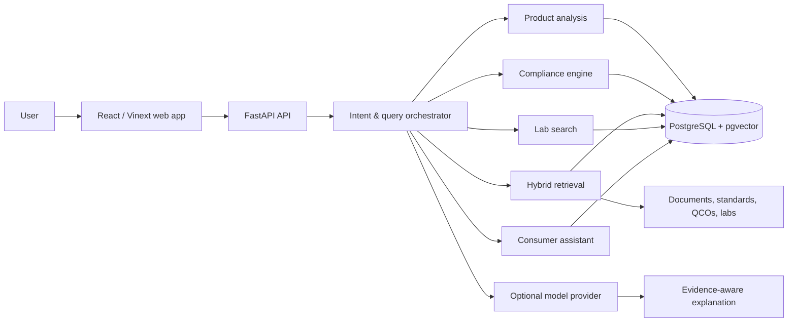

# ManakAI

**Indian Standards & BIS Compliance Intelligence**

ManakAI is a hackathon-ready regulatory navigation and compliance automation prototype. It turns a product description into a structured product profile, candidate standards, an explicit verification boundary, testing/document tasks, laboratory matches and an auditable compliance journey. Conversational AI is one interaction layer—not the product itself.

> Demo mode is intentionally conservative. Seeded standard metadata and every laboratory record are labelled fixtures. The system does not assert a legal obligation unless a current, authoritative structured source supports it.

## What works

- Product-to-standard analysis for seeded electrical, consumer-safety and construction scenarios
- Detailed compliance profile with explainability, warnings, evidence register and action journey
- Searchable standards explorer and detail views
- Structured laboratory filtering with synthetic fixture records
- Evidence-aware technical Q&A fallback
- Separate consumer/HUID guidance flow
- English-first UI with Hindi/Hinglish-ready request schema
- FastAPI REST API and OpenAPI docs
- Explicit compliance rule engine and version-precedence logic
- Deterministic demo mode with no API key or network dependency
- Automated frontend contract and backend unit/API tests

## Architecture



The web app lives at the repository root so it can use the Sites/Cloudflare runtime. The modular Python service lives in `backend/`; fixtures, benchmark data, scripts and design documentation are separated by concern.

## Run locally

Requirements: Node 22.13+, npm, Python 3.12+.

```bash
npm install
npm run dev
```

In a second terminal:

```bash
python3 -m venv backend/.venv
source backend/.venv/bin/activate
pip install -r backend/requirements.txt
uvicorn app.main:app --app-dir backend --reload --port 8000
```

Open the web app at `http://localhost:3000`, the API at `http://localhost:8000`, and OpenAPI at `http://localhost:8000/docs`.

## Run with Docker

```bash
cp .env.example .env
docker compose up --build
```

This starts the frontend (`3000`), backend (`8000`) and PostgreSQL/pgvector (`5432`). The demo API currently reads deterministic fixtures while the SQLAlchemy model defines the production persistence boundary.

## Test and validate

```bash
npm test
npm run build
python -m pytest backend/tests
python scripts/evaluate_demo.py
```

Tests never call paid or external model providers.

## Environment

Copy `.env.example` to `.env`. `DEMO_MODE=true` and `LLM_PROVIDER=mock` are safe defaults. Provider keys are optional and must never be committed. A real provider is intentionally not invoked until an evidence source is available; changing the model must never change a structured regulatory fact.

## Data and migrations

SQLAlchemy tables are defined in `backend/app/db_models.py`. Alembic is included, but the first migration is intentionally deferred until authoritative BIS identifiers and source-adapter contracts are validated; fixture IDs must not become production primary keys accidentally.

## Limitations

- No live BIS, QCO, product-manual, lab-recognition or HUID connection is included.
- Standard text is not distributed; only demo metadata is stored.
- Laboratory names are synthetic and are not BIS recognition claims.
- Authentication, submission, payments and native apps are out of scope.
- Regulatory decisions remain `UNVERIFIED` unless an authoritative source is connected.

See [Architecture](docs/ARCHITECTURE.md), [Data model](docs/DATA_MODEL.md), [Retrieval](docs/RETRIEVAL.md), [Compliance engine](docs/COMPLIANCE_ENGINE.md), [Demo guide](docs/DEMO.md), and [Adding a source](docs/ADDING_DATA_SOURCE.md).
