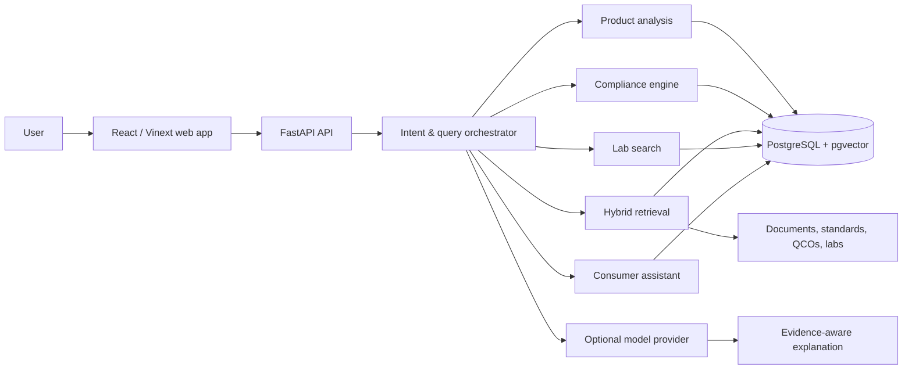

# ManakAI

**Indian Standards & BIS Compliance Intelligence**

ManakAI is a hackathon-ready regulatory navigation and compliance automation prototype. It turns a product description into a structured product profile, candidate standards, an explicit verification boundary, testing/document tasks, laboratory matches and an auditable compliance journey. Conversational AI is one interaction layer—not the product itself.

> Two isolated modes are supported. `DEMO_MODE=true` uses labelled synthetic fixtures. `DEMO_MODE=false` uses only ingested BIS/government evidence and an explicit coverage registry. Verified/partial coverage now includes electric kettles, motorcycle helmets, Ordinary Portland Cement, domestic pressure cookers and gold hallmarking. Missing attributes remain visible warnings rather than invented facts.

## What works

- Product-to-standard analysis for seeded electrical, consumer-safety and construction scenarios
- Detailed compliance profile with explainability, warnings, evidence register and action journey
- Searchable standards explorer and detail views
- Structured laboratory filtering with synthetic fixture records
- Evidence-aware technical Q&A fallback
- Separate consumer/HUID guidance flow
- English-first UI with Hindi/Hinglish-ready request schema
- FastAPI REST API and OpenAPI docs
- Active SQLAlchemy repositories, Alembic migrations and PostgreSQL/pgvector persistence
- Generated TypeScript API contracts and TanStack Query remote-state handling
- Explicit compliance rule engine and version-precedence logic
- Deterministic demo mode with no API key or network dependency
- Automated frontend contract and backend unit/API tests
- Authoritative electric-kettle classification, IS 302 Part 2/Sec 15:2009 mapping, IS 302 Part 1:2024 framework, QCO S.O. 1739(E), Scheme I, February 2024 product manual and dated BIS LIMS scopes
- Source-adapter pipeline with allow-listed fetches, staged validation, ingestion runs, content hashes and non-destructive version history
- Query-date and enterprise-category QCO resolution
- Clause-aware chunks, PostgreSQL full-text indexes, configurable local embeddings, hybrid rank fusion and citation validation
- Controlled OpenAI/Gemini provider boundary with Pydantic outputs and deterministic failure fallback
- PostgreSQL-backed conversations with clarification/follow-up merging and English/Hindi/Hinglish support
- Evidence-ID answer packages, regulatory-fact validation and prompt-injection resistance
- Generic product-category → standard → instrument → regime → evidence decision graph across five authoritative coverage records
- Explicit `VERIFIED`, `PARTIAL`, `METADATA_ONLY` and `UNSUPPORTED` coverage states; ambiguous “helmet” input never auto-selects IS 4151
- Separate BIS Hallmarking regime, official HUID-to-BIS-Care boundary and structured consumer guidance
- Current and historical pressure-cooker standards/product manuals plus versioned hallmarking orders

## Architecture



The native Next.js web app lives at the repository root and deploys to Vercel. The modular Python service lives in `backend/` and deploys as a Docker web service; fixtures, benchmark data, scripts and design documentation are separated by concern.

## Run locally

Requirements: Node 22.13+, npm, Python 3.12+.

```bash
npm install
npm run dev
```

In a second terminal (PostgreSQL must be reachable at `DATABASE_URL`):

```bash
python3 -m venv backend/.venv
source backend/.venv/bin/activate
pip install -r backend/requirements.txt
backend/.venv/bin/alembic -c backend/alembic.ini upgrade head
PYTHONPATH=backend backend/.venv/bin/python -m app.seed
uvicorn app.main:app --app-dir backend --reload --port 8000
```

Open the web app at `http://localhost:3000`, the API at `http://localhost:8000`, and OpenAPI at `http://localhost:8000/docs`.

## Run with Docker

```bash
cp .env.example .env
docker compose up --build
```

This starts the frontend (`3000`), backend (`8000`) and PostgreSQL/pgvector (host `5433`, container `5432`). Set `POSTGRES_PORT` to override the host port. Backend startup applies Alembic migrations and idempotently seeds deterministic demo rows into PostgreSQL.

To run all authoritative verticals after the database is up:

```bash
DEMO_MODE=false docker compose up -d --build
docker compose exec backend python -m app.ingestion all-authoritative
```

The sanitised fixtures are captured official-source snapshots. Re-running ingestion is hash-aware and idempotent; `--dry-run` validates without committing the regulatory graph. Individual targets are `electric-kettle`, `helmets`, `cement`, `pressure-cookers` and `hallmarking`.

To inspect unresolved source drift without changing canonical facts:

```bash
python -m app.ingestion review-report --fail-on-pending
```

Production resolution uses the manual `Resolve authoritative source review` GitHub workflow. Each decision is bound to the exact detected hash and records reviewer attribution; material acceptance is blocked until newer reviewed canonical data has been ingested.

Optional local embeddings are explicitly provisioned and never downloaded at application startup:

```bash
pip install sentence-transformers
EMBEDDING_PROVIDER=sentence-transformers python -m app.ingestion embeddings --allow-model-download
```

## Test and validate

```bash
npm test
npm run lint
npm run build
backend/.venv/bin/pytest backend
backend/.venv/bin/python scripts/evaluate_demo.py
npm run test:e2e
```

Tests use captured/sanitised source fixtures, a fake 384-dimensional embedding provider and recorded/disabled AI providers; they never call live BIS pages or paid model providers.

## Environment

Copy `.env.example` to `.env`. `DEMO_MODE=true` and `LLM_PROVIDER=disabled` are safe defaults. Provider keys are optional and must never be committed. Set `LLM_PROVIDER=openai` or `gemini`, select `LLM_MODEL`, and provide only the corresponding key. Changing or disabling the model cannot change a structured regulatory fact.

The free staging topology is Vercel (frontend), Render Free (FastAPI) and Neon Free (PostgreSQL/pgvector). `render.yaml` intentionally declares only the free API service. The daily GitHub workflow uses the `NEON_DATABASE_URL` repository secret to detect official-source changes without replacing verified records. See the deployment runbook for the account-owner sequence.

## Data and migrations

SQLAlchemy tables are defined in `backend/app/db_models.py`. Migration `4b2f2a8d1c71` adds provenance, ingestion, temporal applicability, category mappings, clause structure, citation validation and PostgreSQL GIN/HNSW indexes; follow-up `7a91d3e5f620` lets demo and authoritative editions coexist without silently merging them. `python -m app.seed` is idempotent. `python -m app.seed --reset` is deliberately restricted to `DEMO_MODE=true`.

Migration `91c3d7e2a4b8` adds structured conversation persistence, `b48f761da923` adds staging telemetry, `d7e2c9a4f610` adds Phase 2E coverage/regime/hallmarking structures, and `f3c8a1d2e740` adds auditable regulatory-source review resolution. The frontend contract is generated from FastAPI's OpenAPI document with `npm run generate:api`. Regenerate it after changing backend schemas.

## Limitations

- The authoritative corpus is intentionally limited to five bounded Phase 2E verticals and captured official-source snapshots; scheduled checks flag source change and still require human regulatory review.
- Full standards text is not stored or redistributed. Only official metadata and limited product-manual/QCO/LIMS excerpts needed for technical retrieval are retained.
- Laboratory coverage remains selective. Users must re-check each linked live scope, exclusions and validity before arranging testing.
- Authentication, submission, payments and native apps are out of scope.
- Regulatory decisions remain `UNVERIFIED` unless an authoritative source is connected.
- This is publishable as an engineering/demo prototype, not as a regulatory decision product.
- The frontend requires a separately reachable FastAPI deployment through `NEXT_PUBLIC_API_URL`; a frontend-only host is insufficient.

See [Deployment](docs/DEPLOYMENT.md), [Staging](docs/STAGING.md), [Operations](docs/OPERATIONS.md), [Privacy](docs/PRIVACY.md), [AI layer](docs/AI_LAYER.md), [AI safety](docs/AI_SAFETY.md), [Evaluation](docs/EVALUATION.md), [Authoritative data](docs/AUTHORITATIVE_DATA.md), [Architecture](docs/ARCHITECTURE.md), [Data model](docs/DATA_MODEL.md), [Retrieval](docs/RETRIEVAL.md), [Compliance engine](docs/COMPLIANCE_ENGINE.md), [Demo guide](docs/DEMO.md), and [Adding a source](docs/ADDING_DATA_SOURCE.md).

For a prompt-to-implementation trace, production-readiness gaps and the recommended development sequence, see [Project status and roadmap](docs/PROJECT_STATUS.md).
