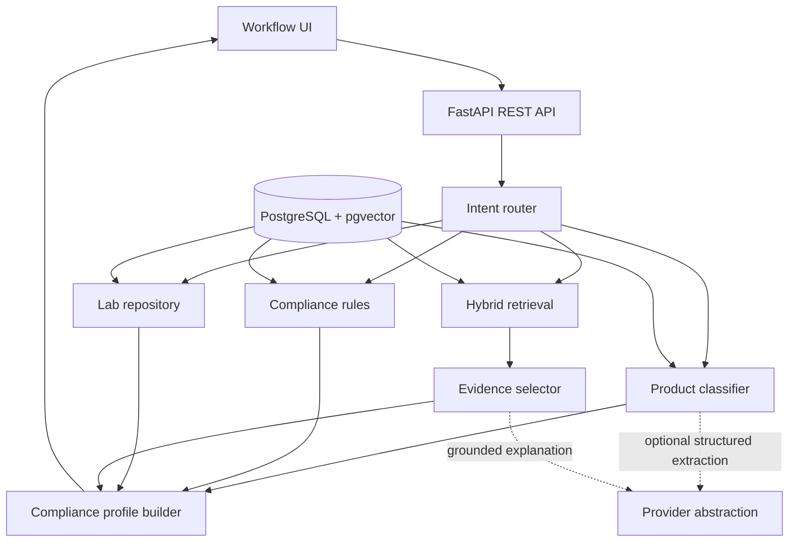

# Architecture

ManakAI uses a modular monolith: one React/Vinext web surface, one FastAPI service and one relational data layer. This keeps the prototype demonstrable while preserving seams for authoritative data, retrieval and model providers.

The current demo replaces the database repositories and provider with deterministic fixtures. The API contracts stay the same, so authoritative adapters can replace fixtures without rewriting the UI.

Key boundaries:

- Intent routing is inspectable and deterministic as a fallback.
- LLM output may classify/explain but cannot set legal status.
- Compliance rules accept structured QCO/standard records only.
- Evidence carries document/version/location/provenance metadata.
- The UI distinguishes fixture, verified and unverified states.
