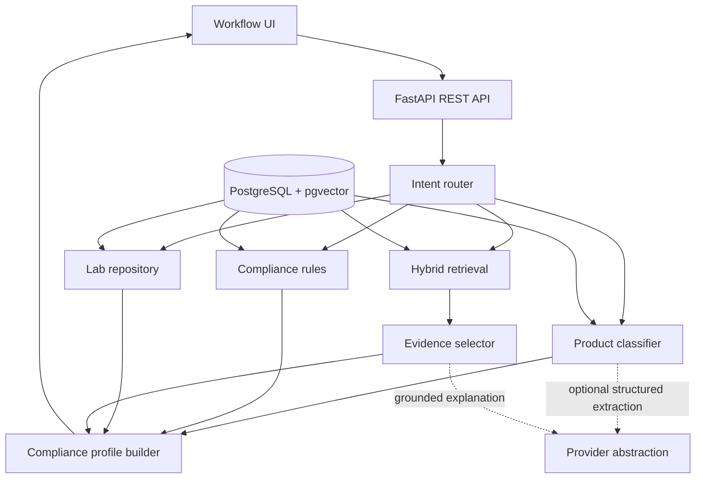

# Architecture

ManakAI uses a modular monolith: one native Next.js web surface, one FastAPI service and one relational data layer. This keeps the prototype demonstrable while preserving seams for authoritative data, retrieval and model providers.

The authoritative path remains deliberately one-way:

```text
Official BIS/DPIIT/LIMS source
→ source-specific adapter
→ normalized record + validation
→ staged transaction + ingestion run
→ PostgreSQL
→ repository/service/rule engine
→ FastAPI
→ typed frontend
```

The browser never calls or parses BIS pages. Source failure rolls back the staged transaction and retains the last verified graph.

Phase 2C adds an optional language boundary: `message → structured interpretation → deterministic engine/retrieval → regulatory answer package → optional provider explanation → answer validator → prose + structured UI payload`. Provider output never feeds standards, QCO, certification, laboratory or temporal-rule tables. Conversation rows retain structured state and recent messages, not hidden reasoning. Evidence IDs are assigned only after citation validation.



Both modes use the complete canonical path. `DEMO_MODE=true` filters APIs to deterministic `DEMO` rows. `DEMO_MODE=false` filters to `AUTHORITATIVE` / `VERIFIED_DERIVED` rows and currently accepts only the kettle vertical.

Key boundaries:

- Intent routing is inspectable and deterministic as a fallback.
- LLM output may classify/explain but cannot set legal status.
- Compliance rules accept structured QCO/standard records only.
- Evidence carries document/version/location/provenance metadata.
- The UI distinguishes fixture, verified and unverified states.
- Browser code does not import regulatory fixture modules or calculate compliance status.
- Alembic owns schema evolution; startup never calls `create_all()`.
- URL validation permits only HTTPS BIS/DPIIT hosts, follows only allow-listed redirects, applies timeouts and enforces a 12 MiB maximum document size.
- Retrieval selects evidence; the temporal rule engine remains the only source of regulatory status.
- OpenAI and Gemini calls are isolated behind one provider boundary with Pydantic validation, timeouts, bounded retries and output limits.
- Provider failure or contradiction cannot make compliance unavailable; deterministic templates are mandatory fallbacks.
- `render.yaml` declares one free FastAPI Docker service. Its startup applies additive migrations and idempotently loads the captured kettle graph into an external Neon PostgreSQL/pgvector database.
- Vercel builds the native Next.js frontend only after `NEXT_PUBLIC_API_URL` is set to the public API origin.
- GitHub Actions runs the daily non-destructive official-source check against Neon; detected changes are recorded as `REVIEW_REQUIRED` and fail the workflow for human attention.
- `/health` reports process liveness; `/ready` verifies database access, the exact Alembic revision and the authoritative kettle corpus.
