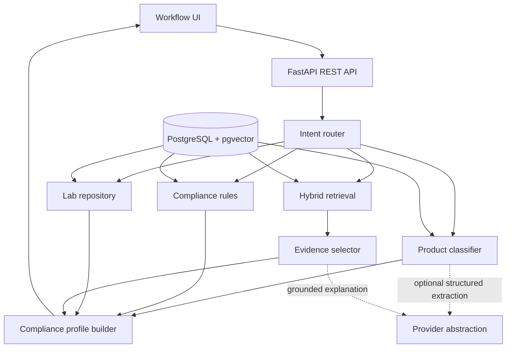

# Architecture

ManakAI uses a modular monolith: one React/Vinext web surface, one FastAPI service and one relational data layer. This keeps the prototype demonstrable while preserving seams for authoritative data, retrieval and model providers.

The current demo uses the complete canonical path: Vinext pages call a generated, typed API client; TanStack Query owns remote state; FastAPI delegates to services and SQLAlchemy repositories; PostgreSQL stores all regulatory demo entities. Deterministic seed data replaces only the external authoritative source adapters and model provider—not the persistence or API layers.

Key boundaries:

- Intent routing is inspectable and deterministic as a fallback.
- LLM output may classify/explain but cannot set legal status.
- Compliance rules accept structured QCO/standard records only.
- Evidence carries document/version/location/provenance metadata.
- The UI distinguishes fixture, verified and unverified states.
- Browser code does not import regulatory fixture modules or calculate compliance status.
- Alembic owns schema evolution; startup never calls `create_all()`.
